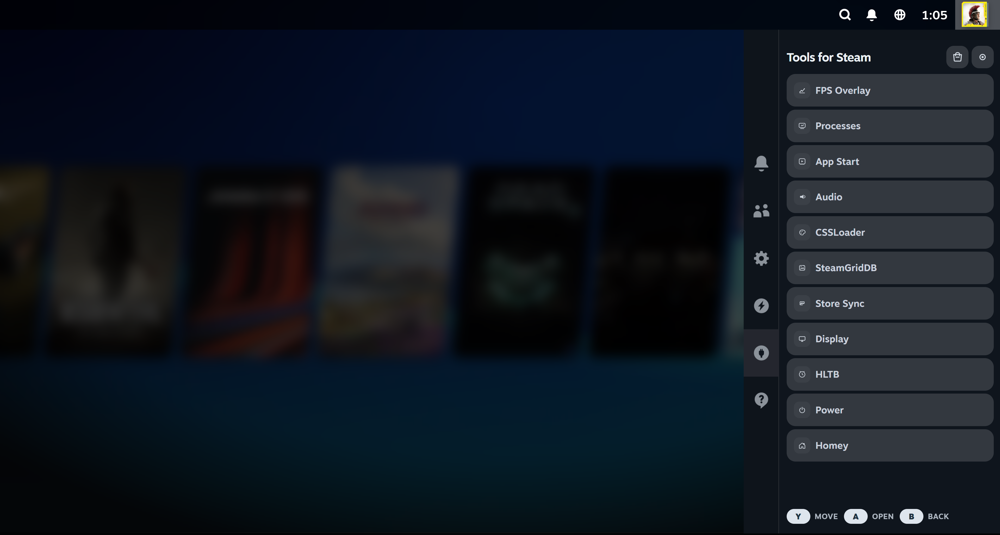

<div align="center">

# Tools for Steam

### A controller-first Windows console layer for Steam Big Picture

[](https://github.com/toonymak1993/tools-for-steam/releases)
[](#requirements)
[](#built-in-tools)
[](#startup-modes)

Tools for Steam (TFS) brings a SteamOS-style experience to Windows gaming PCs and handhelds. It integrates directly into Steam's Quick Access panel, starts cleanly into Big Picture, and keeps the important Windows and gaming controls reachable without leaving the controller.

[Download a release](https://github.com/toonymak1993/tools-for-steam/releases)

</div>



> [!IMPORTANT]
> The current public build is a beta. TFS changes the current user's startup experience and integrates with Steam UI surfaces that can change after Steam updates. Read [Safety and recovery](#safety-and-recovery) before enabling Console Mode.

## Why Tools for Steam?

Windows is a powerful gaming platform, but it was not designed to feel like a console from the sofa. TFS connects the missing pieces:

| Console feature | What TFS provides |
|---|---|
| Native controller UI | A Tools for Steam tab inside Steam Quick Access, built for `A`, `B`, bumpers, D-pad, and sticks |
| Console startup | Console Mode starts the gaming session right after sign-in and covers the desktop until Big Picture is ready |
| One gaming hub | Launcher discovery, non-Steam shortcuts, collections, and SteamGridDB artwork |
| System controls | Audio, displays, windows, performance, themes, apps, power, and recovery from Big Picture |
| Curated tools | Included plugins selected and shipped by the Tools for Steam author |

TFS is part of **GCM — Gaming Console Mode**. The goal is simple: on a living-room PC or handheld, Steam should be the first-class home experience while Windows remains recoverable underneath.

## Highlights in the first official beta

- Controller-native Plugin Activator with artwork, descriptions, and direct on/off controls for included plugins.
- No public marketplace, community catalog, third-party installation, or community runtime in the product.
- Console Mode with Explorer as the shell, installer rollback snapshots and a desktop that stays reachable if the gaming start fails.
- Controller focus and Store card layout fixes across 720p, 1080p, and larger displays.

## TDP Control and handheld support

This beta includes our first dedicated **Handheld Performance / TDP Control plugin**.

The first verified device is the **MSI Claw A8** (`MS-1T8K`). On supported hardware the plugin appears automatically and provides:

- direct TDP control from **15 W to 35 W**;
- Battery `15 W`, Balanced `20 W`, and Performance `28 W` presets;
- separate plugged-in and battery limits;
- automatic per-game TDP profiles;
- live battery, power-source, applied-TDP, and game information;
- profile notifications and automatic restoration of the global profile;
- elevated hardware access through the bundled PawnIO-based helper.

The plugin stays hidden on unverified devices instead of applying unknown hardware commands. **More handheld models will follow** as their hardware identity, safe limits, and control path are verified.

## Built-in tools

| Tool | Purpose |
|---|---|
| **Performance** | Automatically installed RTSS with SteamOS-style modes, FPS/frametime/1% low telemetry, graphs, and per-game frame limiting |
| **Processes** | List visible windows and bring an app to the foreground |
| **App Start** | Curate and launch installed Windows apps with a controller |
| **Store Sync** | Discover launcher libraries, create Steam shortcuts and collections, and refresh artwork |
| **OmniLibrary** | Prepare Xbox, Xbox Cloud, Epic, and GOG as native Steam tabs, with one controller-native Download Center for progress and transfer actions |
| **TFS Artworks** | Search SteamGridDB, compare resolution quality, and apply game artwork from Steam context menus |
| **TFS Curtain** | Hide desktop and launcher transitions behind each game's artwork until a stable game window is ready; toggle it per game |
| **Audio** | Switch playback devices, control volume, and manage mixer state |
| **Display** | Switch displays, resolutions, and refresh rates |
| **CSSLoader** | Control local themes, profiles, presets, and backend tools |
| **HLTB** | Show HowLongToBeat estimates on supported game pages |
| **Discord** | See online friends, pin favorite servers, browse approximate presence counts, and optionally get friend-online notifications |
| **Auto SISR** | Optional marker-mode automation for selected non-Steam games |
| **Homey** | Optional rooms, lights, moods, colors, and flows integration |
| **Power** | Restart Steam, recover Explorer, sleep, restart, or shut down safely |

Most tools can be hidden from TFS Settings. Safety and recovery actions remain available.

### OmniLibrary

OmniLibrary is an alternative to Store Sync: only one can run at a time. Each enabled and connected provider is prepared in the background, then appears as its own **Xbox**, optional **Xbox Cloud**, **Epic**, or **GOG** tab after Steam has reloaded the prepared state. Selecting a title uses Steam's normal game page. Only managed OmniLibrary entries have their native Play label changed to Download while absent; installed games keep Steam's original Play action. The Download Center at the top of OmniLibrary combines simultaneous provider transfers with progress, pause, resume, safe two-step cancellation, recent history, and controller navigation. Xbox keeps native transfer control in the official app; Epic and GOG use their resumable managed helpers.

Xbox uses the official Xbox app session, PC Game Pass catalog data, and local `XboxGames` manifests. Direct installation is best effort because Microsoft's broker uses a private capability; the safe fallback opens the exact Xbox product page and never automates a confirmation. Xbox uninstall also opens the exact product page for the user to finish. Epic and GOG sign-ins use isolated sessions. Their downloads and managed uninstalls run through pinned, SHA-256-verified Legendary and heroic-gogdl helpers obtained from the official upstream releases. See [OmniLibrary architecture](docs/omnilibrary.md) and the bundled third-party notices.

The Performance tool reuses existing RTSS binaries and settings without reinstalling them. Setup only grants the installing user write access to RTSS' data-only `Profiles` folder so per-game frame limits can be saved without an elevated TFS service. Only when RTSS is missing does Setup install the tested 7.3.7 WinGet package; Tools for Steam then uses the RTSS shared-memory and profile APIs. It owns one isolated OSD slot, writes only per-game profiles, leaves other RTSS clients untouched, and does not uninstall RTSS because another application may still use it. RTSS is third-party freeware by Unwinder/Guru3D and is downloaded separately rather than bundled into Tools for Steam.

### Discord setup

1. Enable the built-in **Discord** plugin in the Plugin Activator or Settings.
2. Open **Discord > Friends** in Quick Access and select **Connect Discord**.
3. Sign in in Discord's browser window and approve the friends/presence permission.
4. Return to Tools for Steam to see currently online friends and browse your Discord servers.
5. Use **Manage Server Favorites** to pin frequently used servers. Pinned servers appear in the first, collapsible section above friends and all other servers. You can also press the controller Menu/Options button on a server row to pin or unpin it directly.
6. Optional: enable **Notify When a Friend Comes Online** in Discord Settings to receive a Tools for Steam notification after a friend changes from offline to online.

The primary integration uses the official Discord Social SDK and requests `openid sdk.social_layer_presence guilds`. Discord handles browser sign-in and consent; Tools for Steam never requests a password or bot token. OAuth access and refresh tokens are protected with Windows DPAPI for the current Windows account and are removed when the user disconnects. Favorite server IDs and the optional notification preference are stored locally. When friend-online notifications are enabled, TFS checks presence in the background and suppresses alerts for friends who were already online when monitoring started. Discord's supported user API exposes an approximate online count per server, but not the identities of individual online server members.

The former [public server widget](https://docs.discord.com/developers/resources/guild#get-guild-widget) remains available as an optional fallback. It still requires the server owner to enable **Server Settings > Engagement > Server Widget**, and it can show only data that Discord exposes publicly.

For internal development and release publishing, create and approve a Discord application, enable **Public Client**, accept the Social SDK terms, and build with `-p:DiscordClientId=<application-id>` or set `TOOLS_FOR_STEAM_DISCORD_CLIENT_ID`. The Windows x64 Social SDK runtime and Discord license notices are copied into published builds automatically.

## Plugin Activator

The Plugin Activator is a controller-friendly list of the plugins included in the current Tools for Steam build. Each row contains its artwork, a short description, current state, and a direct Activate or Deactivate control. Safety-critical plugins remain active. It does not discover, download, install, update, or execute third-party plugins.

## Startup modes

### Console Mode

Explorer stays the Windows shell. A visible Task Scheduler sign-in task of the current user starts TFS right after sign-in; TFS covers the desktop with its splash, opens Steam Big Picture and hides the taskbar while Big Picture is up. Start Windows Desktop shows the desktop, and the Guide button or Big Picture brings the console back. If TFS fails, the normal desktop is simply there.

The former Shell Mode (TFS as the Windows shell) and the Windows Xbox Mode integration were removed. Installs that used either are moved to Console Mode automatically: Explorer becomes the shell again, the Windows Gaming Home settings from before TFS are restored, and the old Gaming Home package and its certificate are removed.

### Tray Mode

Windows starts normally and TFS runs quietly as a tray-style launcher service. This is the least invasive option and the easiest starting point for testing the beta.

## Requirements

- Windows 10 or Windows 11 x64;
- Steam with Big Picture / Gamepad UI;
- a controller for the intended console experience;
- permission to install per-user software under `%LOCALAPPDATA%`.

TFS starts Steam with the required local DevTools endpoint on `127.0.0.1:8080` when necessary. If Steam is already running without it, TFS can perform one controlled restart to attach correctly. The local TFS API listens on `127.0.0.1:47652` and uses a private session token for protected routes.

## Install and update

1. Open [GitHub Releases](https://github.com/toonymak1993/tools-for-steam/releases).
2. For the first official beta, expand the newest **Pre-release** entry.
3. Download `ToolsForSteamSetup.exe`.
4. Run the installer and choose Shell or Tray Mode.

The installer:

- installs per-user under `%LOCALAPPDATA%\Programs\ToolsForSteam`;
- closes TFS, helpers, and Steam when required;
- creates a rollback snapshot before an update;
- removes the retired Xbox Mode package, certificate, and Gaming Home settings left by older versions;
- restores a safe startup mode if setup cannot complete.

Installed builds can update from GitHub releases. Public installer assets are named `ToolsForSteamSetup.exe`.

## Safety and recovery

TFS changes only the current user's shell/startup configuration. It does not replace Windows system files.

If the gaming shell does not start correctly:

- open `Tools for Steam > Settings` and switch back to Tray Mode;
- use `Tools for Steam > Power > Start Windows Desktop`;
- start Explorer from the TFS tray recovery actions;
- press `Ctrl+Shift+Esc`, open Task Manager, and run `explorer.exe`;
- uninstall from Windows Apps or the Start Menu entry;
- use the rollback snapshot stored under the TFS data directory after an interrupted upgrade.

## Build from source

```powershell
dotnet build .\SteamLoader.slnx
dotnet run --project .\src\SteamLoader.App\SteamLoader.App.csproj
```

Build the complete installer:

```powershell
powershell -ExecutionPolicy Bypass -File .\scripts\publish-installer.ps1
```

Outputs:

- `dist\installer\ToolsForSteamSetup.exe` — public installer;
- `dist\installer\ToolsForSteamSetup-<version>.exe` — versioned copy;
- `dist\portable\ToolsForSteam.exe` — internal installer payload.

The outer installer should be Authenticode-signed for broad public distribution.

## Repository map

| Path | Purpose |
|---|---|
| `src/SteamLoader.App/Hosting` | Local API, Plugin Activator routes, Steam injection, and live state |
| `src/SteamLoader.App/Infrastructure` | Audio, displays, handhelds, Store Sync, Steam, themes, artwork, and native services |
| `src/SteamLoader.App/Assets` | Quick Access, Plugin Activator, game-page, controller, and Steam UI assets (`tfs-core.mjs` = Decky-style runtime in Steam's shared context) |
| `scripts` | Build, installer, release, and owner development helpers |
| `installer` | Inno Setup definition and startup-mode recovery |
| `tests` | Runtime, Plugin Activator, startup mode, launcher, and update regression tests |

## Beta status

This is the first official beta of the complete TFS platform: console startup, curated built-in tools, the Plugin Activator, and the first MSI Claw A8 TDP integration.

Feedback is especially useful for:

- Steam Beta and stable-client UI compatibility;
- controller focus at 720p, 1080p, ultrawide, and 4K;
- fresh installs and upgrades in Console Mode, including installs moving over from the removed Shell Mode and Xbox Mode;
- MSI Claw A8 power limits and automatic game profiles;
- activation and deactivation of included plugins.

Some internal namespaces still use the original `SteamLoader` codename; the user-facing product is **Tools for Steam / TFS**.
