<div align="center">

# Tools for Steam

### The controller-first console layer for Steam on Windows

[](https://github.com/toonymak1993/tools-for-steam/releases/tag/v0.2.0)
[](#requirements)
[](#startup-modes)

**[⬇️ Download Open Beta 0.2.0](https://github.com/toonymak1993/tools-for-steam/releases/tag/v0.2.0)** · [All releases](https://github.com/toonymak1993/tools-for-steam/releases)

</div>

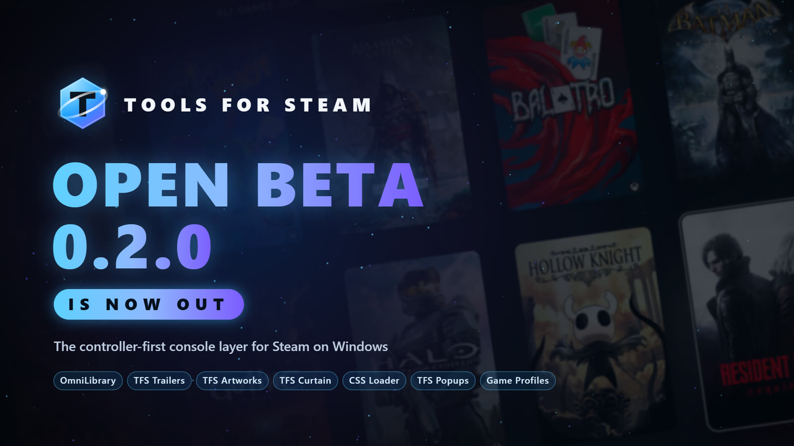

Tools for Steam (TFS) turns Steam Big Picture on a Windows PC or handheld into a real console. It lives in its own tab in Steam's Quick Access menu, uses Steam's own components everywhere, boots straight into Big Picture, and keeps every important Windows and gaming control one button press away. No mouse, no desktop, no detours.

> [!IMPORTANT]
> **This is an Open Beta.** TFS runs on more handhelds, PCs and setups than one person can test, so there will be bugs. Please report every crash, glitch and "huh, that's weird" in [Issues](https://github.com/toonymak1993/tools-for-steam/issues). New Open Beta installers will keep dropping over the next days as fixes land, so keep an eye on the [releases page](https://github.com/toonymak1993/tools-for-steam/releases).

## ✨ What's new in Open Beta 0.2.0

| | |
|---|---|
| 🧩 **Native from the inside** | TFS has its own tab in Quick Access and is built from Steam's own UI components, so it feels like Steam. |
| 📚 **OmniLibrary** | Steam, Epic, GOG and Xbox in one library, downloaded and installed right inside Big Picture. Games you install or remove elsewhere are picked up automatically. |
| 🖥️ **Console Mode** | Boot straight into Big Picture behind a smarter splash screen that waits for Steam, even through Steam updates. |
| 🎨 **Fresh look** | A brand-new TFS logo, a proper Start menu entry, and TFS Curtain for clean game launches. |
| 💬 **Discord, built in** | Chat without leaving Big Picture, with the Steam keyboard on every text field and Steam Controller 2 support. |
| 🔔 **TFS Popups** | Clean notifications with several designs, sizes and sounds. |
| 🎵 **TFS Overture** | Game music that plays while you browse your library. |
| 🎬 **TFS Trailers** | The game's Steam trailer plays in the game page header. |
| ⚡ **Handheld power** | Per-game TDP profiles from the context menu, plus audio, display and performance controls in Quick Settings. |
| ⏱️ **Rich game pages** | HowLongToBeat, achievements and metadata for your non-Steam games too. |
| 📺 **Controller intro** | A short video on first launch shows the basics: tap View for the Steam menu, hold it for Quick Access and TFS. |

## A tour

### TFS in Quick Access

Every tool sits in its own Quick Access tab, built for `A`, `B`, bumpers, D-pad and sticks.

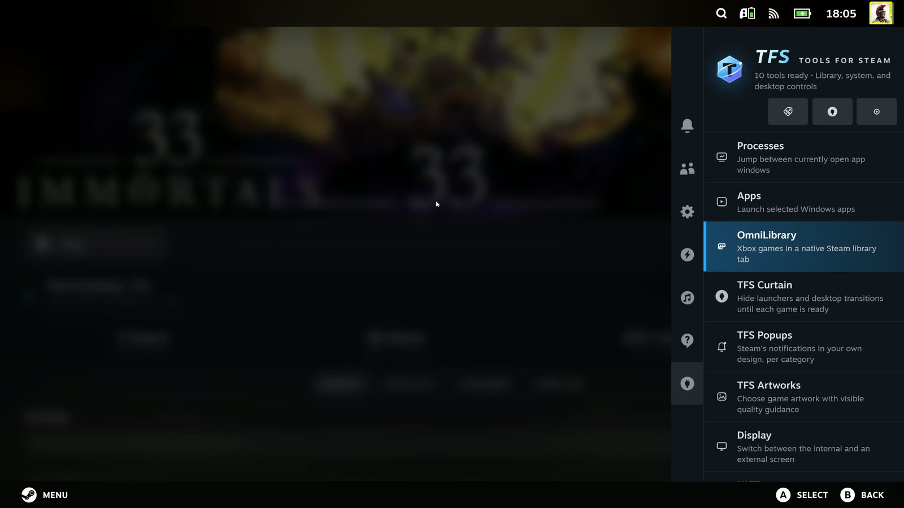

### OmniLibrary

Xbox, Epic and GOG games appear as native Steam library tabs next to your Steam games. Selecting a game opens Steam's normal game page, and missing games can be downloaded from right there.

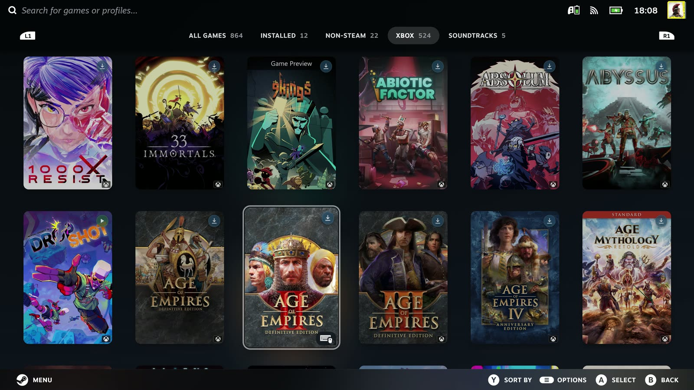

The Download Center keeps every transfer in one place, with progress, pause, resume and safe cancel. Games installed or removed outside of Steam are picked up automatically.

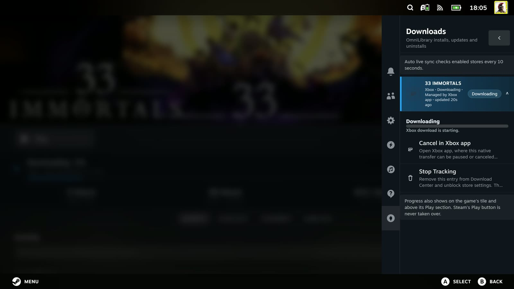

### Game pages for every game

Non-Steam games get HowLongToBeat times, achievements, news and metadata on the same Steam game page.

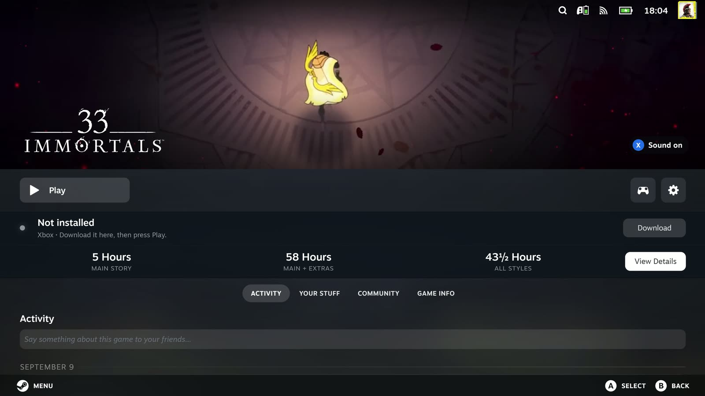

TFS Trailers plays the game's trailer in the header, and TFS Overture plays its soundtrack while you browse.

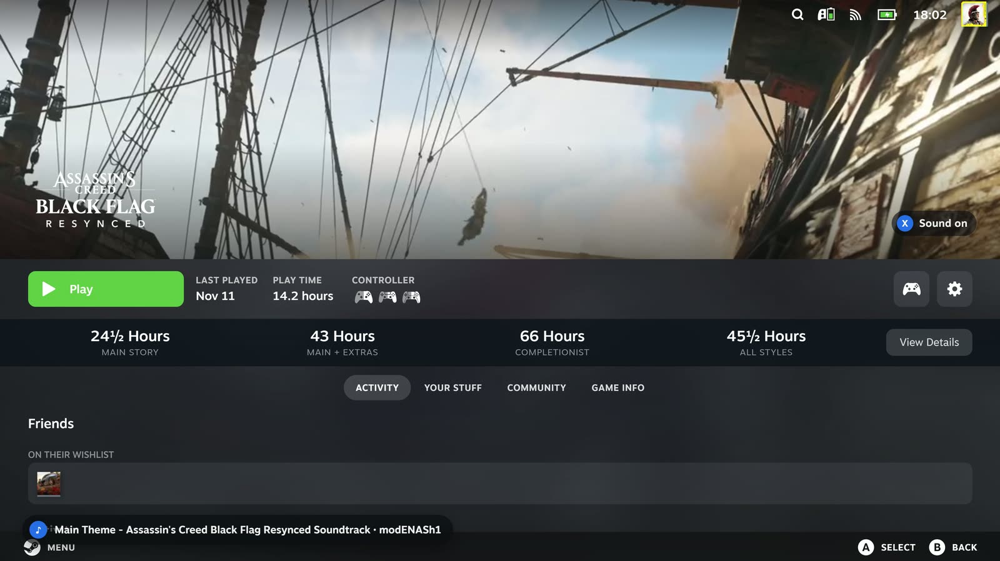

### TFS Artworks

Pick covers, heroes and logos from SteamGridDB right from the game's context menu, sorted best quality first.

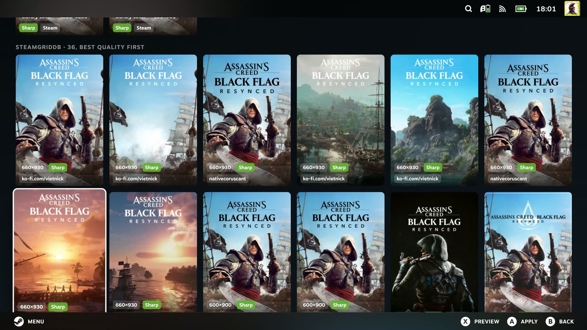

### TFS Curtain

Launchers and desktop flashes stay hidden behind the game's artwork until the game window is ready. Mode, image and layout can be set per game.

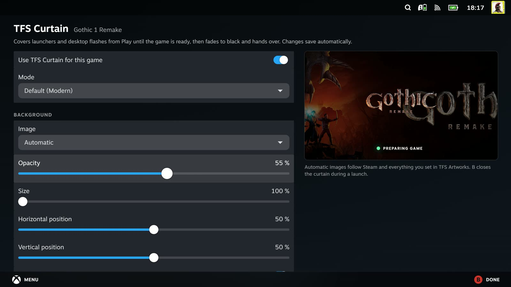

### Game Profiles and Quick Settings

Set TDP, frame limit, refresh rate, Windows power mode and RTSS per game. Profiles switch automatically when the game starts and back afterwards.

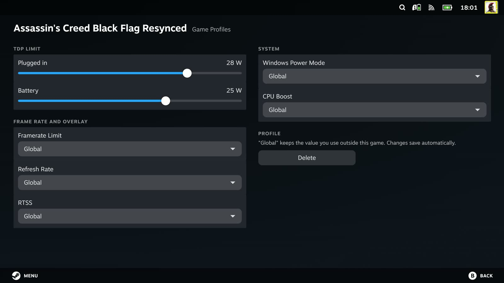

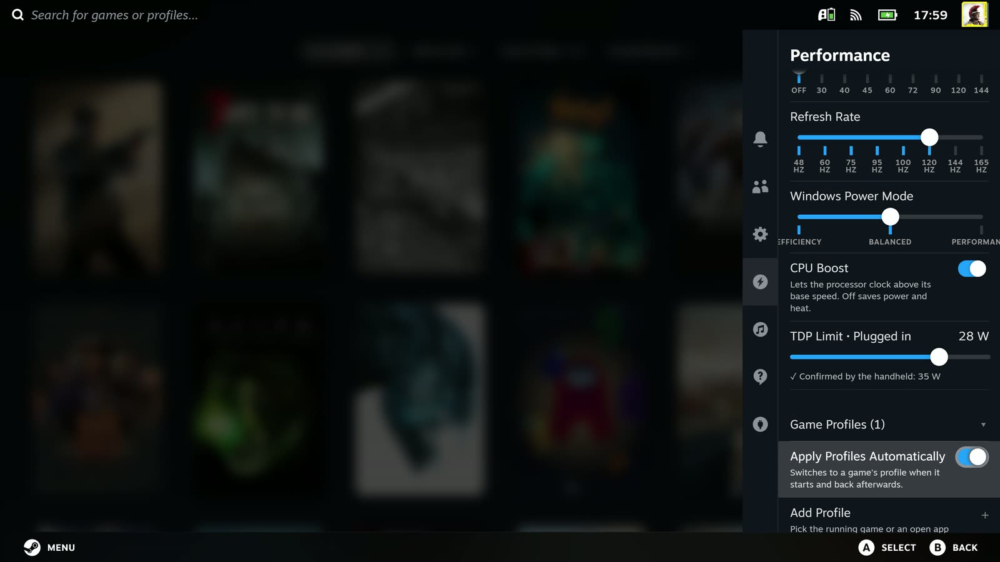

### TFS Popups

Steam notifications in your own design, size and sound.

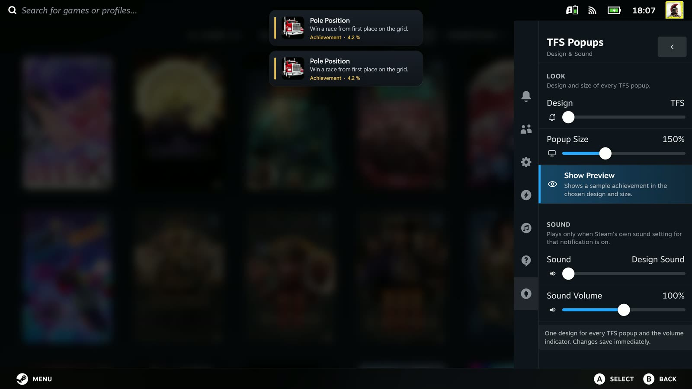

### Theme Store

Browse and apply CSS Loader themes with the controller.

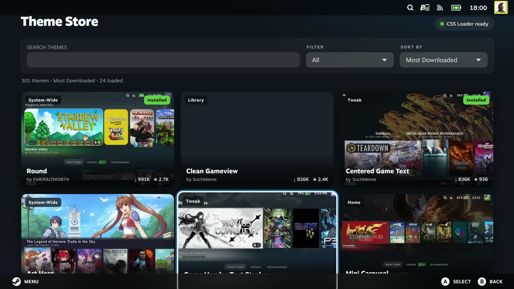

## Install

1. Open the [Open Beta 0.2.0 release](https://github.com/toonymak1993/tools-for-steam/releases/tag/v0.2.0).
2. Download `ToolsForSteamSetup-0.2.0.exe`. It is signed by *Open Source Developer Luis Antonio Garcia Roque* (Certum).
3. Run the installer and pick a startup mode. **Console Mode** is recommended for couch and handheld setups.

Open Beta builds are published as pre-releases and are not installed by the automatic updater. Install each new beta from the releases page. Coming from 0.4.x? TFS restarted its version numbers with this beta, so install it once by hand.

## Startup modes

### Console Mode (recommended)

Explorer stays the Windows shell. A visible sign-in task for the current user starts TFS right after sign-in; TFS covers the desktop with its splash, opens Steam Big Picture and waits for Steam, even while Steam updates. If TFS fails, the normal desktop is simply there.

### eTray

Windows starts normally and TFS runs quietly in the background. This is the least invasive option and a good starting point for testing.

## Requirements

- Windows 10 or Windows 11 x64
- Steam with Big Picture
- A controller for the intended console experience
- Administrator rights during setup, once, to register the hidden hardware helper task (`\ToolsForSteam\GamepadHelper`) for controller input and TDP control, so TFS itself never needs a UAC prompt for them

Handheld TDP control supports the MSI Claw A8 and handhelds with supported AMD APUs. On other devices the TDP components are skipped.

TFS starts Steam with its local DevTools endpoint on `127.0.0.1:8080` when needed. The local TFS API listens on `127.0.0.1:47652` and uses a private session token for protected routes.

## Safety and recovery

TFS changes only the current user's startup configuration. It does not replace Windows system files.

If the console start does not work:

- switch the startup mode to eTray in the TFS settings in Quick Access;
- use **Start Windows Desktop** in the TFS tray menu;
- press `Ctrl+Shift+Esc`, open Task Manager and run `explorer.exe`;
- uninstall from Windows Apps or the Start menu.

## Reporting bugs

The Open Beta lives from your reports. A good report says:

- your device (PC or handheld model) and Windows version;
- your Steam client (stable or beta);
- the startup mode you use;
- what you did, what you expected, and what happened instead.

Open an [issue](https://github.com/toonymak1993/tools-for-steam/issues) for each problem. Every report goes straight into the next build.

## Build from source

```powershell
dotnet build .\SteamLoader.slnx
dotnet run --project .\src\SteamLoader.App\SteamLoader.App.csproj
```

Build the installer (signing needs the Certum certificate; use `-Unsigned` for local tests):

```powershell
powershell -ExecutionPolicy Bypass -File .\scripts\publish-installer.ps1
```

Outputs:

- `dist\installer\ToolsForSteamSetup.exe` and `dist\installer\ToolsForSteamSetup-<version>.exe`
- `dist\portable\ToolsForSteam.exe` (installer payload)

## Repository map

| Path | Purpose |
|---|---|
| `src/SteamLoader.App/Hosting` | Local API, Steam injection and live state |
| `src/SteamLoader.App/Infrastructure` | OmniLibrary, Steam, handhelds, displays, audio, artwork, Discord, popups and native services |
| `src/SteamLoader.App/Assets` | Quick Access, game page and Steam UI assets (`tfs-core.mjs` is the runtime in Steam's shared context) |
| `installer` | Inno Setup definition and startup-mode recovery |
| `scripts` | Build, signing and release helpers |
| `tests` | .NET and JavaScript regression tests |
| `docs` | Architecture notes and README images |

Some internal namespaces still use the original `SteamLoader` codename; the product is **Tools for Steam / TFS**.

## ❤️ Thank you

To everyone who tested, reported, suggested and simply waited: this release is yours as much as mine. Let's build the console Windows never had, together.
